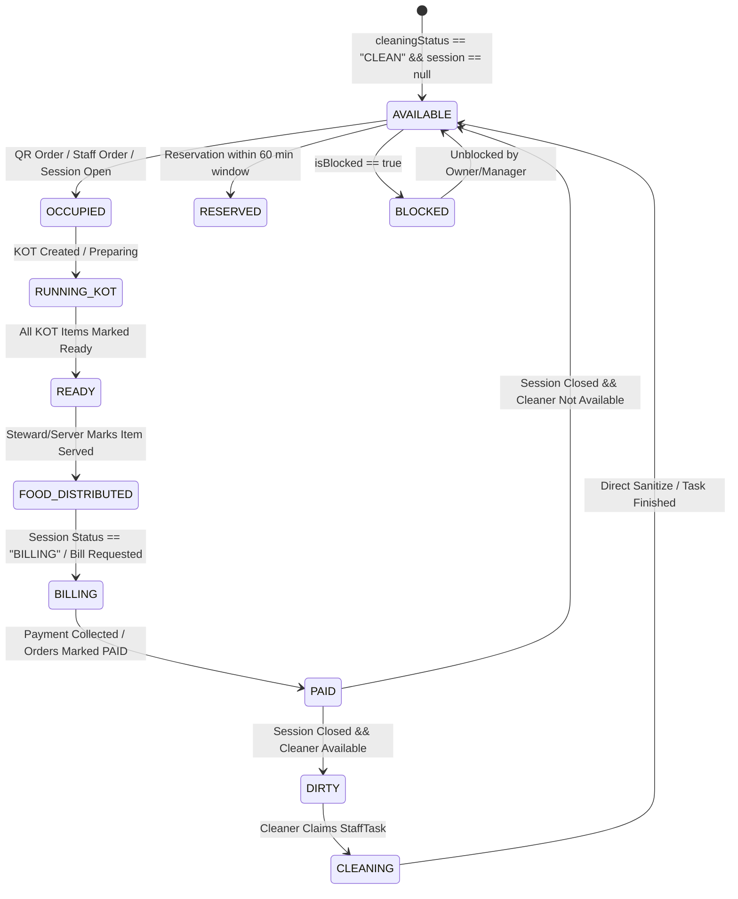
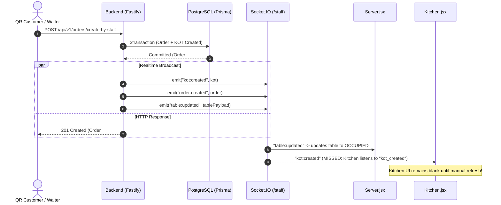

# PRODUCTION-GRADE FORENSIC AUDIT: TIFFZY RESTAURANT PLATFORM
## Cross-Module Table, Order, Session, KOT, and Notification Lifecycle Parity

**Audit Date:** October 31, 2026  
**Target Repository:** `https://github.com/anilchowdarya8/cafe-system.git`  
**Target Branch:** `main`  
**Current HEAD Commit:** `c2c98b127b9c544a9fb2dd0bb1676e31f44fb55b`  
**Verified Production Commit:** `adbb8a05436910d7bb3d69f593b9493624ffaa28`  
**Production URLs:**  
- Web Frontend: `https://www.tiffzy.com`  
- Backend API: `https://api.tiffzy.com`  

---

## 1. Executive Summary

This forensic audit was commissioned to determine the exact root causes behind operational state drift across the Tiffzy restaurant platform. Operational screens—including **Owner Dashboard**, **Server Station**, **Kitchen (KDS)**, **Cashier Station**, **Steward Station**, and **Cleaner Station**—frequently report diverging table states, conflicting order statuses, missed notifications, or lingering "READY" indicators after food has been delivered.

The architectural objective of Tiffzy is strictly defined as:
```text
ONE PHYSICAL TABLE
        ↓
ONE CANONICAL DiningTable.id
        ↓
ONE TABLE SESSION (TableSession.id)
        ↓
ONE OR MORE ORDERS (Order.id[])
        ↓
KOT / KITCHEN ITEMS (KitchenOrderTicket.id / KitchenOrderTicketItem.id[])
        ↓
READY (KitchenPass / Distribution Queue)
        ↓
SERVER / STEWARD DISTRIBUTION
        ↓
FOOD SERVED / DELIVERED
        ↓
PAYMENT SETTLEMENT
        ↓
SESSION CLOSURE
        ↓
TABLE SANITATION (CLEANER)
        ↓
TABLE AVAILABLE
```

### Key Forensic Findings:
1. **Critical Prisma Schema Relation Bug in Production:**  
   Runtime crash in `PUT /api/v1/staff/food-runner-items/:itemId/delivered` caused by attempting to include `table` on `KitchenOrderTicket` (which does not exist on the model). While partially mitigated in commit `c2c98b12`, a residual query bug remains in `backend/src/controllers/kot.controller.js` (line 229) selecting `tableId` directly on `db.order.findUnique`, which triggers an unhandled Prisma exception because `Order` does not have a `tableId` column.
2. **Broken Kitchen Realtime Ingestion (`kot:created` vs `kot_created`):**  
   The backend emits `kot:created` on the Socket.IO `/staff` namespace, but `frontend/src/pages/Kitchen.jsx` listens exclusively to `kot_created` (with an underscore). Consequently, line chefs on `Kitchen.jsx` **never receive real-time ticket alerts** when orders are placed; tickets only appear if the chef manually navigates away, changes filters, or triggers a page reload.
3. **Food Distribution Sync Gap (Why Kitchen Shows READY After Delivery):**  
   When a Steward or Server marks an item delivered via `/api/v1/staff/food-runner-items/:itemId/delivered`, the event `food:delivered` is emitted. `OwnerKitchenLive.jsx` listens to this event and refreshes live orders, but `Kitchen.jsx` routes `food:delivered` exclusively to `onKitchenHistoryUpdated` (which only loads the History tab). The live active KOT cards on `Kitchen.jsx` are never refreshed from this event, leaving the card visually stuck in `READY`. Furthermore, if an order has multiple items and only one is delivered, the parent KOT status calculation in `staffTasks.routes.js` leaves the KOT status as `READY`.
4. **Client-Side `localStorage` Grouping Overriding Database Truth:**  
   Floor sections ("Main Hall", "Terrace", "AC Floor") are parsed and overridden client-side by `frontend/src/utils/tableGrouping.js` storing table groups inside the browser's `localStorage` (`owner_table_groups_v1_${restaurantId}`). A server or steward logging in on an iPad or handheld device has an empty `localStorage`, causing their UI to fall back to hardcoded regex heuristics (e.g. numeric tables become "Main Hall", or "Location not configured"), while the Owner's browser displays custom named sections.
5. **Non-Atomic Settle & Release Mutations (Risk of Zombie Sessions):**  
   Both in `backend/src/routes/staffTasks.routes.js` (`POST /api/v1/staff/billing/settle`) and `backend/src/routes/owner.js` (`POST /owner/:restaurantId/tables/:tableNo/settle-bill`), order payment is committed inside a database transaction, but `completeSessionAndReleaseTable` is called **outside** the transaction. If `completeSessionAndReleaseTable` encounters an error, the payment is committed to the database, but the table session remains `OPEN`, the table remains `OCCUPIED`, and subsequent attempts to settle fail with `already_paid`, permanently wedging the table in a zombie occupied state.
6. **QR Order Realtime Event Leak:**  
   Customer dine-in orders placed via QR code (`POST /r/:slug/order` or `qrService.js`) emit socket events to the root namespace `io` instead of the `/staff` namespace (`io.of("/staff")`). Handheld staff stations connected via `useStaffSocket()` do not receive real-time table occupancy or order creation events for QR customer orders. Furthermore, customer orders placed via `POST /r/:slug/order` create an `Order` record but **fail to create KOT records**, relying on a fallback inside `kot.controller.js` to backfill KOTs on subsequent GET requests.

---

## 2. Repository Baseline & Git Provenance

### Git Status & Working Tree Baseline
- **Branch:** `main`
- **HEAD Commit:** `c2c98b127b9c544a9fb2dd0bb1676e31f44fb55b`
- **Commit Date:** Sat Oct 31 19:28:53 2026 +0530
- **Author:** Anil kumar Thammineni (`anilchowdarya8@gmail.com`)
- **Remote `origin/main`:** In exact parity with local `HEAD` (`c2c98b12`).
- **Working Tree:** Clean (`nothing to commit, working tree clean`).
- **Untracked Files:** None.
- **Modified Files:** None.

### Commit History Trajectory
The repository history exhibits rapid iterative hotfixing around table identity and food distribution over the past 24 hours:

```text
c2c98b12 (HEAD -> main, origin/main) fix: harden food distribution state synchronization
9f241003 fix(table-identity): permanently eliminate fuzzy table matching, harmonize socket payloads, and expand cross-module tests to 30 scenarios
3a01ecf7 (tag: safety-hardening-3a01ecf7) fix: enforce permanent canonical table identity and cross-module state sync
adbb8a05 [Previously Verified Production Commit] fix: enforce canonical table identity and cross-module state parity
81c6e394 fix: enforce end-to-end canonical table identity and cleaning isolation
749ce42f fix: isolate cleaning state by canonical table id
242da452 fix: deploy canonical backend and harden table identity isolation
2c99b5af fix: enforce canonical table id isolation
c925ca78 fix: resolve order delivery lifecycle and dual server-owner delivery notifications
20560467 fix: enforce table identity and notification isolation
```

### Commit Differential Analysis (`adbb8a05` vs `HEAD`)
Between the verified production commit (`adbb8a05`) and current `HEAD` (`c2c98b12`):
- Commit `3a01ecf7` attempted to introduce strict table identity lookups into `staffTasks.routes.js`, but introduced the production runtime Prisma syntax error by including `table` on `KitchenOrderTicket`.
- Commit `9f241003` eliminated fuzzy string matching in `TableStateContext.jsx` and added 30 synthetic test cases in `backend/src/tests/canonicalTableIdentityConsistencyHardening.test.js`.
- Commit `c2c98b12` corrected the include in `staffTasks.routes.js` to nest `table` under `tableSession`, wrapped state mutations in a transaction, and added unit tests in `foodDistributionLifecycleHardening.test.js`.

---

## 3. Canonical Table Identity Contract

### Database Schema Model: `DiningTable`
In `backend/prisma/schema.prisma` (lines 647–694):
```prisma
model DiningTable {
  id                 Int       @id @default(autoincrement())
  restaurantId       Int       @map("restaurant_id")
  restaurant         Restaurant @relation(fields: [restaurantId], references: [id], onDelete: Cascade)
  tableNo            String    @map("table_no")
  seats              Int       @default(4)
  section            String?   @default("Main Floor")
  positionX          Float?    @map("position_x")
  positionY          Float?    @map("position_y")
  width              Int?      @default(120)
  height             Int?      @default(100)
  shape              String?   @default("RECTANGLE")
  rotation           Int?      @default(0)
  qrCodeUrl          String?   @map("qr_code_url")
  qrToken            String?   @unique @map("qr_token")
  assignedWaiterId   Int?      @map("assigned_waiter_id")
  assignedWaiterName String?   @map("assigned_waiter_name")
  isActive           Boolean   @default(true) @map("is_active")
  cleaningStatus     String?   @default("CLEAN") @map("cleaning_status") // CLEAN | DIRTY | IN_PROGRESS
  isBlocked          Boolean   @default(false) @map("is_blocked")
  blockReason        String?   @map("block_reason")
  blockedAt          DateTime? @map("blocked_at")
  blockedByName      String?   @map("blocked_by_name")
  createdAt          DateTime  @default(now()) @map("created_at")
  updatedAt          DateTime  @default(now()) @updatedAt @map("updated_at")

  tableSessions      TableSession[]
  reservations       Reservation[]
  waitlists          Waitlist[]
  staffTasks         StaffTask[]

  @@unique([restaurantId, tableNo])
  @@index([restaurantId, isActive])
  @@index([restaurantId, section])
  @@index([restaurantId, cleaningStatus])
  @@map("dining_tables")
}
```

### Table Identity Classification Matrix
Every reference across backend and frontend was audited and classified:

| Code Location | Identification Syntax | Classification | Risk Analysis |
| :--- | :--- | :--- | :--- |
| `backend/src/utils/tableIdentity.js#L18` | `getCanonicalTableIdentity({ restaurantId, tableId })` | **SAFE** | Constructs immutable string `${restaurantId}:${tableId}`. |
| `frontend/src/context/TableStateContext.jsx#L42` | `getCanonicalTableKey({ restaurantId, tableId })` | **SAFE** | Keyed by restaurant and primary key ID. |
| `backend/src/routes/staffTasks.routes.js#L561` | `prisma.diningTable.findUnique({ where: { id: tableId } })` | **ACCEPTABLE** | Scoped to table primary key with restaurant match check. |
| `frontend/src/context/TableStateContext.jsx#L405` | `getTableByNo(tableNo) { tables.find(t => t.tableNo.toLowerCase() === norm) }` | **VERY DANGEROUS** | Case-insensitive string search. Collides if duplicate table numbers exist across sections. |
| `backend/src/routes/owner.js#L3898` | `prisma.diningTable.findFirst({ where: { restaurantId, tableNo: { equals: rawParam, mode: "insensitive" } } })` | **VERY DANGEROUS** | Case-insensitive fuzzy string match; resolves arbitrary table if duplicate names exist. |
| `backend/src/routes/owner.js#L3916` | `orderWhereOr.push({ tableSessionId: null, tableNo: diningTable.tableNo })` | **DANGEROUS** | Associates unlinked orders by raw string `tableNo` rather than canonical table session. |
| `frontend/src/pages/Server.jsx#L386` | `(targetNo && String(prev.tableNo).trim().toLowerCase() === String(targetNo).trim().toLowerCase())` | **VERY DANGEROUS** | Releases or mutates selected table based on string equality fallback, leading to cross-table release leaks. |
| `frontend/src/pages/Server.jsx#L798` | `if (!prev \|\| (prev.id !== data.tableId && String(prev.tableNo) !== String(data.tableNo)))` | **DANGEROUS** | If `data.tableId` does not match, but `data.tableNo` does, the component permits state updates on the wrong table. |
| `frontend/src/pages/Server.jsx#L1045` | `navigate('/server?table=' + encodeURIComponent(tableNo))` | **DANGEROUS** | Navigation query parameter encodes human string `tableNo` instead of `tableId`. |
| `frontend/src/utils/tableGrouping.js#L125` | `if (/^\d+$/.test(noKey)) return "Main Hall";` | **VERY DANGEROUS** | Synthesizes section names client-side using regex rather than relying on database truth. |
| `backend/src/controllers/kot.controller.js#L229` | `db.order.findUnique({ select: { tableId: true } })` | **P0 RUNTIME ERROR** | Invalid Prisma schema invocation. `Order` does not have `tableId`. |

---

## 4. Complete Table State Model

### State Definition & Authoritative Truth



### Table State Resolution Discrepancy Matrix

| State | Database Column Truth | Backend Service Source | Socket Event Emitted | Frontend Context (`TableStateContext`) | Component Divergence (`OwnerTables` vs `Server`) |
| :--- | :--- | :--- | :--- | :--- | :--- |
| **AVAILABLE** | `cleaningStatus = 'CLEAN'`, `isBlocked = false`, `tableSessions.status = 'CLOSED'` | `tableSessionService.js#completeSessionAndReleaseTable` | `table:updated` with `status: "AVAILABLE"` | Sets `status: "AVAILABLE"`, `isOccupied: false` | `OwnerTables.jsx` requires `!isOccupied && !isBilling && !isPaid && !isDirty`. If `sessionStatus == 'BILLING'`, it hides table from available. |
| **OCCUPIED** | Active `TableSession` with `status IN ('OPEN', 'BILLING', 'PAID')` OR active `Order` with `status IN ('PLACED', 'ACCEPTED', 'PREPARING', 'READY')` | `orderService.js#createOrderByStaff`, `owner.js#handleGetOwnerTables` | `table:session_updated`, `table:updated` | Sets `isOccupied: true`, `status: "OCCUPIED"` | `Server.jsx` derives occupancy from `table.isOccupied \|\| activeOrders.length > 0`. |
| **RUNNING** | Active KOT with `status = 'PREPARING'` | `kot.controller.js#updateStatus` | `kot:status_updated`, `kot:item_updated` | Not stored as distinct status; remains `OCCUPIED` | `OwnerTables.jsx` renders badge `"Running"`. `Server.jsx` displays kitchen progress bar. |
| **READY** | All active KOT items have `status = 'READY'` | `staffTasks.routes.js`, `kot.controller.js` | `kitchen:item_ready`, `kot:status_updated` | Ignored by `TableStateContext`; handled in `Server.jsx` | `Server.jsx` maintains local `realtimeAddedReadyItems` array. `Kitchen.jsx` shows emerald badge. |
| **BILLING / PAYMENT_PENDING** | `table_sessions.status = 'BILLING'` OR order delivered but unpaid | `qrService.js#requestBillForTable`, `owner.js` | `bill:requested`, `table:session_updated` | Sets `status: "BILLING"` or `"PAYMENT_PENDING"` | `CashierStation.jsx` queries unpaid orders queue. `Server.jsx` highlights payment alert button. |
| **PAID** | `orders.payment_status = 'SUCCESS'`, but `table_sessions.status` not yet closed | `staffTasks.routes.js#L1435` | `order:updated`, `payment:updated` | Sets `paymentStatus: "PAID"` | `OwnerTables.jsx` renders badge `"Paid"`. `Server.jsx` shows "Settle" button disabled. |
| **DIRTY** | `dining_tables.cleaning_status = 'DIRTY'` AND pending `staff_tasks` row | `tableSessionService.js#L730` | `table:updated` with `status: "DIRTY"`, `cleaner:table_dirty` | Sets `cleaningStatus: "DIRTY"`, `status: "DIRTY"` | **Critical Bug:** `owner.js#L1184` will silently reset a dirty table to `CLEAN` during GET if no `staffTask` is found. |
| **CLEANING** | `dining_tables.cleaning_status = 'IN_PROGRESS'` | `staffTasks.routes.js#handleStartTask` | `task:updated` | Shows in Cleaner Station | Not explicitly reflected in `TableStateContext`; defaults to `DIRTY` until finished. |
| **BLOCKED** | `dining_tables.is_blocked = true` | `owner.js#L1411` | `table:updated` with `status: "BLOCKED"` | Sets `status: "BLOCKED"`, `isBlocked: true` | Blocks order placement across Server and QR ordering screens. |

---

## 5. Complete Order Lifecycle

### Step-by-Step Execution Path & State Transitions

```text
[Customer / Server Action]
        │
        ▼ (POST /api/v1/orders/create-by-staff OR POST /r/:slug/order)
1. Controller: orderController.createByStaff / staffTasks.routes.js
        │
        ▼
2. Service: orderService.createOrderByStaff
   - Validates MenuItems & stock
   - Resolves or creates active TableSession (status: "OPEN")
   - Calculates bill with taxes, service charge, and discounts
   - Atomically creates Order record in $transaction (status: "PLACED", paymentStatus: "PENDING")
   - Calls createKotsForOrder -> Creates KitchenOrderTicket & KitchenOrderTicketItem records
        │
        ▼
3. Socket Emissions:
   - emitOrderCreated(order) -> staff.to("restaurant:RID").emit("order:created")
   - emitKotCreated(kot) -> staff.to("restaurant:RID").emit("kot:created")  <-- [FAILED IN KITCHEN.JSX]
        │
        ▼
4. Kitchen KDS (Kitchen.jsx / OwnerKitchenLive.jsx):
   - Chef clicks "Start Preparing" -> PUT /owner/:restaurantId/kots/:kotId/status (status: "PREPARING")
   - Backend updates KitchenOrderTicket.status = "PREPARING"
   - Emits kot:status_updated -> Kitchen cards switch to amber "PREPARING"
        │
        ▼
5. Kitchen Food Ready:
   - Chef clicks "Mark Ready" -> PUT /owner/:restaurantId/kots/:kotId/status (status: "READY")
   - Backend updates KitchenOrderTicket.status = "READY"
   - Backend updates all KitchenOrderTicketItem.status = "READY"
   - Emits kot:status_updated, kitchen:item_ready, notification:new (FOOD_READY)
        │
        ▼
6. Server / Steward Food Distribution:
   - Server sees ready items in "Ready to Distribute" drawer
   - Steward clicks "Deliver" -> PUT /api/v1/staff/food-runner-items/:itemId/delivered
   - Backend executes $transaction in staffTasks.routes.js:
     * Updates KitchenOrderTicketItem.status = "SERVED"
     * Re-evaluates KOT: if all items SERVED -> KOT.status = "SERVED"
     * Re-evaluates Order: calls syncParentOrderStatusFromKots -> Order.status = "DELIVERED"
   - Emits food:delivered, kot:item_updated, order:updated, table:updated
        │
        ▼
7. Payment Settlement:
   - Cashier clicks "Confirm Payment" -> POST /api/v1/staff/billing/settle
   - Validates authoritative total against database
   - Creates Payment record (status: "SUCCESS")
   - Updates Order.paymentStatus = "SUCCESS"
   - Calls completeSessionAndReleaseTable:
     * Checks if all orders for session are paid
     * Marks TableSession.status = "CLOSED"
     * Checks dynamic cleaner availability via hasActiveCleaner
     * If cleaner on duty -> sets DiningTable.cleaningStatus = "DIRTY" & creates StaffTask
     * If no cleaner on duty -> sets DiningTable.cleaningStatus = "CLEAN"
   - Emits table:updated, table:session_updated, cleaner:table_dirty
        │
        ▼
8. Cleaning & Sanitation:
   - Cleaner sees task in CleanerStation.jsx
   - Cleaner finishes task -> PUT /api/v1/staff/tasks/:taskId/finish (or POST /api/v1/staff/tables/:id/clean)
   - Updates DiningTable.cleaningStatus = "CLEAN", assignedWaiterId = null
   - Emits table:updated (status: "AVAILABLE"), cleaner:table_cleaned
   - Table is ready for new guests.
```

---

## 6. Forensic Investigation: Production Bug (Unknown Field `table` on `KitchenOrderTicket`)

### Error Log from Production
```text
Invalid prisma.kitchenOrderTicketItem.findFirst() invocation:
Unknown field `table` for include statement on model `KitchenOrderTicket`. Available options are marked with ?:
  include: {
    kot: {
      include: {
        tableSession: {
          select: {
            id: true,
            tableId: true,
            tableNo: true,
            table?: true
          }
        },
        table?: true,
        order?: true
      }
    }
  }
```

### Exact Cause & Route Origin
1. **The Route:**  
   `PUT /api/v1/staff/food-runner-items/:itemId/delivered` located in `backend/src/routes/staffTasks.routes.js` (line 750).
2. **Commit of Introduction:**  
   Introduced in commit `3a01ecf7` ("fix: enforce permanent canonical table identity and cross-module state sync").
3. **The Flawed Code (Commit `3a01ecf7`):**
   ```javascript
   // backend/src/routes/staffTasks.routes.js (lines 776-784 in 3a01ecf7)
   const existing = await prisma.kitchenOrderTicketItem.findFirst({
     where: { id: itemId },
     include: {
       kot: {
         include: {
           tableSession: { select: { id: true, tableId: true, tableNo: true } },
           table: { select: { id: true, tableNo: true, section: true } }, // <-- CRASH: Field 'table' does not exist on KitchenOrderTicket!
           order: { select: { id: true, tableId: true, tableNo: true } }, // <-- CRASH: Field 'tableId' does not exist on Order!
         },
       },
     },
   });
   ```
4. **Schema Proof:**  
   In `backend/prisma/schema.prisma` (lines 1782–1830), model `KitchenOrderTicket` has the following relations:
   - `restaurant` (`Restaurant`)
   - `tableSession` (`TableSession?`)
   - `order` (`Order`)
   - `station` (`KitchenStation?`)
   - `items` (`KitchenOrderTicketItem[]`)  
   **There is no `table` relation on `KitchenOrderTicket`.**
   Similarly, model `Order` (lines 353–450) has:
   - `tableSessionId` (`Int?`)
   - `tableSession` (`TableSession?`)
   - `tableNo` (`String?`)  
   **There is no `tableId` column or `table` relation on `Order`.**
5. **Secondary Hidden Bug in `kot.controller.js`:**  
   In `backend/src/controllers/kot.controller.js` line 229:
   ```javascript
   const ord = await db.order.findUnique({
     where: { id: ordId },
     select: {
       tableId: true, // <-- CRASHES RUNTIME if ordId fallback executes!
       tableNo: true,
       tableSession: {
         select: {
           tableId: true,
           table: { select: { id: true, tableNo: true, section: true } }
         }
       }
     },
   });
   ```
   If a KOT ticket missing a `tableSessionId` attempts to resolve its table details via the parent order, Prisma throws `Unknown field tableId for select statement on model Order`.

### Minimal Correct Fix
```javascript
// Authoritative, Schema-Accurate Query:
const existing = await prisma.kitchenOrderTicketItem.findFirst({
  where: {
    id: itemId,
    ...(restaurantId ? { kot: { restaurantId } } : {}),
  },
  include: {
    kot: {
      include: {
        tableSession: {
          select: {
            id: true,
            tableId: true,
            tableNo: true,
            table: {
              select: { id: true, tableNo: true, section: true },
            },
          },
        },
        order: {
          select: {
            id: true,
            orderNo: true,
            tableNo: true,
            tableSessionId: true,
            tableSession: {
              select: {
                id: true,
                tableId: true,
                tableNo: true,
                table: {
                  select: { id: true, tableNo: true, section: true },
                },
              },
            },
          },
        },
      },
    },
  },
});
```

---

## 7. Food Distribution & Delivery Workflow Audit

### Why Kitchen Can Show "READY" While Server / Owner Shows "DELIVERED"
A primary symptom reported from production is that when a Server or Steward delivers food to a table, the Server station and Owner dashboard show the item as served, but the Kitchen KDS screen continues to display the item or ticket as "READY".

#### Root Cause 1: Socket Listener Dead End in `Kitchen.jsx`
In `frontend/src/pages/Kitchen.jsx` (lines 626–630):
```javascript
socket.on("kitchen:item_served", onKitchenHistoryUpdated);
socket.on("food:delivered", onKitchenHistoryUpdated);
socket.on("kitchen:item_ready", onKitchenHistoryUpdated);
```
When `food:delivered` is emitted by the backend:
- `onKitchenHistoryUpdated` calls `loadHistoryData(1, true)`.
- It **does not call `loadKots()`**.
- It **does not modify the active `kots` array in state**.
- In contrast, `frontend/src/pages/admin/OwnerKitchenLive.jsx` (line 413) executes:
  ```javascript
  const handleKitchenItemSync = () => {
      loadLiveOrders({ silent: true });
      loadKotHistory();
  };
  socket.on("food:delivered", handleKitchenItemSync);
  ```
  The Owner screen silently re-fetches live orders and removes delivered items, while `Kitchen.jsx` leaves the live tickets untouched.

#### Root Cause 2: Multi-Item KOT Status Retention
In `backend/src/routes/staffTasks.routes.js` (lines 880–895):
```javascript
const activeItems = (reloadedKot?.items || []).filter((it) => it.status !== "CANCELLED");
let autoKotStatus = reloadedKot?.status;
if (activeItems.length > 0 && activeItems.every((it) => it.status === "SERVED")) {
  autoKotStatus = "SERVED";
} else if (activeItems.length > 0 && activeItems.every((it) => it.status === "READY" || it.status === "SERVED")) {
  autoKotStatus = "READY";
}
```
If a customer orders 2 items (e.g. Burger and Fries):
1. Kitchen marks both items READY (KOT status becomes `READY`).
2. Steward delivers the Burger (Burger becomes `SERVED`).
3. Fries remain at the kitchen pass waiting for beverage preparation.
4. The backend evaluation: `activeItems.every(it => it.status === "SERVED")` is `false`.
5. `activeItems.every(it => it.status === "READY" || it.status === "SERVED")` is `true`.
6. Therefore, the KOT status **remains `READY`**.
7. In the Server UI, the Burger is removed from the pickup queue. But on the Kitchen KDS, the entire card remains under the "Ready" header because the ticket itself is still flagged `READY`.

#### Root Cause 3: Inverted State Toggle in Kitchen UI
In `frontend/src/pages/Kitchen.jsx` (line 2439):
```javascript
<button
    type="button"
    disabled={isCancelled}
    onClick={() => {
        const next = isPrep ? "READY" : isReady ? "PENDING" : "PREPARING";
        onUpdateItemStatus(kot.id, it.id, next);
    }}
>
    {it.status || "PENDING"}
</button>
```
If an item has been marked `SERVED` by the Steward:
- `isPrep` (`it.status === "PREPARING"`) is `false`.
- `isReady` (`it.status === "READY"`) is `false`.
- The ternary evaluation computes `next = "PREPARING"`.
- If a chef clicks the button on a served item, it unintentionally transitions backwards from `SERVED` to `PREPARING` in the database, resurrecting the order on all staff screens!

---

## 8. Operational Notification Consistency

### Notification Matrix

| Event Name | Database Record Created | Socket.IO Event | Target Room | Recipient Type | Client Listener | Deduplication / Idempotency Key |
| :--- | :--- | :--- | :--- | :--- | :--- | :--- |
| **ORDER_PLACED** | Yes (`prisma.notification`) | `notification:new`, `order:created` | `user:${waiterId}`, `restaurant:${rid}` | `USER` / `RESTAURANT` | `Server.jsx`, `OwnerLayout.jsx` | `order_sent_${rid}_${orderId}_${waiterId}` |
| **KOT_CREATED** | No | `kot:created` | `restaurant:${rid}` | N/A | `OwnerKitchenLive.jsx` (missed by `Kitchen.jsx`) | None |
| **FOOD_READY** | Yes (`prisma.notification`) | `notification:new`, `kitchen:item_ready` | `restaurant:${rid}:role:WAITER`, `user:${waiterId}` | `WAITER` | `Server.jsx` | `food_ready_${rid}_${itemId}_${waiterId}_READY` |
| **FOOD_DELIVERED** | Yes (`prisma.notification`) | `food:delivered`, `kitchen:item_served` | `restaurant:${rid}` | `WAITER` / `OWNER` | `Server.jsx`, `OwnerKitchenLive.jsx` | `food_delivered_${rid}_${itemId}_${waiterId}` |
| **PAYMENT_SUCCESS** | No | `payment:updated`, `order:updated` | `restaurant:${rid}` | N/A | `CashierStation.jsx`, `Server.jsx` | None |
| **TABLE_DIRTY** | Yes (`prisma.notification`) | `notification:new`, `cleaner:table_dirty` | `restaurant:${rid}:role:CLEANER` | `CLEANER` | `CleanerStation.jsx` | `table_dirty_${rid}_${tableId}_${sessionId}` |
| **TABLE_CLEANED** | Yes (`prisma.notification`) | `notification:new`, `cleaner:table_cleaned` | `restaurant:${rid}:role:OWNER`, `user:${waiterId}` | `OWNER` / `USER` | `OwnerTables.jsx`, `Server.jsx` | `table_cleaned_${rid}_${tableId}_${timestamp}` |
| **TABLE_ASSIGNMENT** | Yes (`prisma.notification`) | `table:waiter_assigned`, `notification:new` | `user:${waiterId}`, `restaurant:${rid}` | `USER` | `Server.jsx` | `table_assign_${rid}_${tableId}_${waiterId}` |
| **BILL_REQUESTED** | Yes (`prisma.notification`) | `bill:requested`, `notification:new` | `restaurant:${rid}:role:CASHIER` | `CASHIER` | `CashierStation.jsx` | `bill_req_${rid}_${tableId}_${timestamp}` |

### Notification Failure Modes
1. **Shared Read State on Role Notifications:**  
   Notifications dispatched to a role (e.g. `recipientType: "CLEANER"`, `recipientId: restaurantId`) persist a single row in `prisma.notification`. When Cleaner A views or clicks the notification, `isRead = true` is set on that database row. When Cleaner B logs in or opens their station, `unreadCount` returns `0`, and the notification appears as already read.
2. **Room Mismatch on Root vs Staff Namespace:**  
   In `backend/src/services/qrService.js` (lines 468–477), events are emitted to `io.to("restaurant_" + rid)` on the default namespace. Staff clients listen exclusively to the `/staff` namespace (`io.of("/staff")`). Staff devices therefore do not receive notification pings for QR orders.
3. **10-Second Deduplication Dropping Valid Consecutive Alerts:**  
   In `frontend/src/pages/Server.jsx` (lines 880–895), notifications are deduplicated in memory using `handledNotificationIdsRef`. If two different items for the same table are marked ready 5 seconds apart, the second notification is silently discarded by the client-side deduplication check because the key format matches `table:${tableId}:${action}`.

---

## 9. Designation & Station Audit

| Designation / Role | Main Page Component | Routes | Primary Table State Source | Primary Order Source | Realtime Socket Namespace | Critical Architectural Divergence |
| :--- | :--- | :--- | :--- | :--- | :--- | :--- |
| **OWNER** | `OwnerTables.jsx`, `OwnerAnalytics.jsx` | `/admin/tables`, `/admin/analytics` | `GET /owner/:id/tables`, `TableStateContext` | `GET /owner/:id/tables` (nested activeOrders) | `/staff` + `/` | Sections overridden by `localStorage`. Modifies DB on GET if orphaned dirty table encountered. |
| **SERVER / WAITER** | `Server.jsx` | `/server`, `/waiter` | `TableStateContext`, `useCachedGet(/owner/:id/tables)` | `TableStateContext.activeOrders`, `/owner/:id/orders` | `/staff` | Uses `tableOverrides` map. Fallback table selection uses `tableNo` string equality, allowing cross-table mutation. |
| **KITCHEN / CHEF** | `Kitchen.jsx`, `OwnerKitchenLive.jsx` | `/kitchen`, `/admin/kitchen` | Derived from KOT `tableNo` | `GET /owner/:id/kots`, `GET /owner/kitchen/orders` | `/staff` | Listens to `kot_created` (underscore) instead of `kot:created`. `food:delivered` only reloads history tab, not live KOTs. |
| **CASHIER** | `CashierStation.jsx` | `/staff/cashier` | `TableStateContext`, `GET /owner/:id/tables` | `GET /owner/:id/tables` | `/staff` | Settle bill fallback routes by `:tableNo`. Matches orders to tables by comparing strings (`t.tableNo === o.tableNo`). |
| **STEWARD** | `StewardStation.jsx` | `/staff/steward` | `TableStateContext` | `GET /api/v1/staff/food-runner-items` | `/staff` | Dependent on `food-runner-items` polling and socket `kitchen:item_ready`. |
| **CLEANER** | `CleanerStation.jsx` | `/staff/cleaner` | `TableStateContext`, `GET /api/v1/staff/tasks` | N/A | `/staff` | Direct sanitize endpoint `/api/v1/staff/tables/:id/clean` works correctly, but task-based finish relies on `StaffTask.tableId`. |
| **SWIPER** | `SwiperStation.jsx` | `/staff/swiper` | `TableStateContext` | `GET /owner/:id/tables` | `/staff` | Uses `/api/v1/staff/billing/settle` with role enforcement (cannot alter amounts or discounts). |
| **SUPER ADMIN** | `Admin.jsx` | `/admin` | Aggregated multi-tenant queries | Aggregated multi-tenant queries | `/staff` + `/` | Joins rooms `superadmin` and `admin`. Full bypass on restaurant isolation checks. |

---

## 10. Realtime & Socket.IO Race Conditions



### Identified Race Conditions:
1. **HTTP Response Arriving After Socket Event:**  
   In `frontend/src/context/TableStateContext.jsx`, if a user releases a table, the socket emits `table:updated` with `status: "AVAILABLE"` and `version: Date.now()`. An in-flight HTTP request triggered 50ms earlier may return the previous state (`status: "OCCUPIED"`). `TableStateContext.jsx` line 194 guards against this with `incomingVer < currentVer && !incomingHasOrders`, but if `activeOrders` was present in the stale response, it can overwrite the newer released state.
2. **Dual Server Station Release Maps:**  
   `Server.jsx` maintains its own local `tableOverrides` state and `tableReleasedTimestampsRef` independent of `TableStateContext.jsx`. If `refreshTables()` is invoked, `Server.jsx` reconciles using its internal override map. If an order is immediately created on that table, `Server.jsx` rejects the new active session unless `session.openedAt > override.releasedAt`. Clock skew between server and client can cause the newly seated session to be hidden.

---

## 11. Database Transaction & Partial Mutation Audit

### Critical Vulnerability: Non-Atomic Settle and Release
In `backend/src/routes/staffTasks.routes.js` (`POST /api/v1/staff/billing/settle`, lines 1285–1490):
```javascript
// Step 1-7: Transaction 1
const result = await prisma.$transaction(async (tx) => {
  // 1. Fetch Order & Session
  // 2. Validate Amount
  // 3. Create Payment record (status: "SUCCESS")
  // 4. Update CashierShift expectedCash
  // 5. Update Order paymentStatus = "SUCCESS"
  return { payment, targetOrder, targetSession, ... };
});

// Step 8: EXECUTED OUTSIDE TRANSACTION!
const { targetOrder, targetSession } = result;
const completionResult = await completeSessionAndReleaseTable({
  prisma,
  tableSessionId: targetSession?.id,
  tableId: targetSession?.tableId,
  restaurantId,
  // ...
});
```

#### Failure Consequence:
If the server crashes, database connection drops, or an error occurs during `completeSessionAndReleaseTable`:
1. `Payment` record is permanently committed as `SUCCESS`.
2. `Order` is permanently marked `PAID`.
3. `TableSession` remains `OPEN` or `BILLING`.
4. `DiningTable` remains `OCCUPIED`.
5. When staff attempts to re-settle or clear the table, line 1305 throws:
   `Order has already been paid and settled (code: already_paid)`.
6. The table cannot be freed by normal settlement workflows and requires manual database intervention.

---

## 12. Duplicate, Unwanted & Dead Code Audit

### Classification Legend
- **KEEP:** Core, active production code.
- **SAFE TO REMOVE:** Completely unreferenced dead code, zero-byte stubs, or legacy backups.
- **DANGEROUS LEGACY CODE:** Code actively in the path that performs obsolete, fuzzy, or insecure operations.
- **DUPLICATE IMPLEMENTATION:** Redundant implementation of an existing capability.

### Audit Findings

| File / Component Path | Status | Finding & Justification |
| :--- | :--- | :--- |
| `backend/src/server_old.js` (91 KB) | **SAFE TO REMOVE** | Monolithic legacy Fastify server file abandoned when modular routing was introduced. Not imported anywhere. |
| `backend/tiffzy_backup_20261019_104337.dump` | **SAFE TO REMOVE** | PostgreSQL binary database dump committed to git repository root. Security and repository bloat risk. |
| `backend/tiffzy_backup_20261019_104513.dump` | **SAFE TO REMOVE** | Second database dump file committed to git repository. |
| `backend/scratch/` & `frontend/scratch/` | **SAFE TO REMOVE** | Ephemeral script directories containing scratch testing dumps. |
| `backend/src/controllers/staff.controller.js` (0 bytes) | **SAFE TO REMOVE** | Empty zero-byte ghost file. |
| `backend/src/controllers/analytics.controller.js` (0 bytes) | **SAFE TO REMOVE** | Empty zero-byte ghost file. |
| `backend/src/controllers/finance.controller.js` (0 bytes) | **SAFE TO REMOVE** | Empty zero-byte ghost file. |
| `backend/src/routes/analytics.routes.js` (0 bytes) | **SAFE TO REMOVE** | Empty zero-byte ghost file. |
| `backend/src/routes/finance.js` (0 bytes) | **SAFE TO REMOVE** | Empty zero-byte ghost file. |
| `backend/src/routes/staff.routes.js` (0 bytes) | **SAFE TO REMOVE** | Empty zero-byte ghost file. |
| `backend/src/routes/finance.routes.js` (0 bytes) | **SAFE TO REMOVE** | Empty zero-byte ghost file. |
| `backend/src/services/billing.service.js` (0 bytes) | **SAFE TO REMOVE** | Empty zero-byte ghost file. Real service is `billingService.js`. |
| `backend/src/services/tableSessionsService.js` (0 bytes) | **SAFE TO REMOVE** | Empty zero-byte ghost file. Real service is `tableSessionService.js`. |
| `backend/src/services/order.service.js` (0 bytes) | **SAFE TO REMOVE** | Empty zero-byte ghost file. Real service is `orderService.js`. |
| `backend/src/services/api.js` (0 bytes) | **SAFE TO REMOVE** | Empty zero-byte ghost file. |
| `frontend/src/pages/staff/POSPage.jsx` (0 bytes) | **SAFE TO REMOVE** | Empty zero-byte ghost file. |
| `frontend/src/pages/staff/TablesPage.jsx` (0 bytes) | **SAFE TO REMOVE** | Empty zero-byte ghost file. |
| `frontend/src/layouts/StaffLayout.jsx` (0 bytes) | **SAFE TO REMOVE** | Empty zero-byte ghost file. |
| `frontend/src/layouts/KitchenLayout.jsx` (0 bytes) | **SAFE TO REMOVE** | Empty zero-byte ghost file. |
| `frontend/src/layouts/CustomerLayout.jsx` (0 bytes) | **SAFE TO REMOVE** | Empty zero-byte ghost file. |
| `frontend/src/store/orderStore.js` (0 bytes) | **SAFE TO REMOVE** | Empty zero-byte ghost file. |
| `backend/src/routes/auth.routes.js` | **SAFE TO REMOVE** | Legacy unmounted auth route file referencing `auth.controller.js`. Active routes are in `backend/src/routes/auth.js`. |
| `backend/src/routes/customerQr.js` | **SAFE TO REMOVE** | Abandoned QR route file. Active QR routes are in `backend/src/routes/qr.routes.js`. |
| `backend/src/controllers/paymentController.js` | **DUPLICATE IMPLEMENTATION** | Legacy Razorpay payment controller superseded by `payment.controller.js` (Cashfree/UPI). |
| `backend/src/controllers/table.controller.js` | **DUPLICATE IMPLEMENTATION** | Standalone table controller superseded by route handlers in `owner.js` and `staffTasks.routes.js`. |
| `frontend/src/pages/Waiter.jsx` (36 bytes) | **SAFE TO REMOVE** | Single line redirecting `export { default } from "./Server";`. |
| `backend/src/controllers/kot.controller.js#L229` | **DANGEROUS LEGACY CODE** | Invalid Prisma schema `select: { tableId: true }` on `Order`. |
| `backend/src/routes/owner.js#L3916` | **DANGEROUS LEGACY CODE** | Fallback query linking orders by `tableNo` string when `tableSessionId` is null. |
| `frontend/src/utils/tableGrouping.js` | **DANGEROUS LEGACY CODE** | Client-side `localStorage` grouping and regex floor allocation overriding DB table section. |

---

## 13. Test Coverage Audit & Missing Scenarios

### Existing Test Assets
- **Backend Unit & Integration Tests:** 81 test files in `backend/src/tests/` (e.g. `foodDistributionLifecycleHardening.test.js`, `canonicalTableIdentityConsistencyHardening.test.js`, `tableCleaningIdentityIsolation.test.js`).
- **Frontend Vitest Suites:** 97 test files in `frontend/src/__tests__/` (e.g. `foodDistributionRealtimeSync.test.jsx`, `canonicalTableCrossModuleDeepSync.test.jsx`).

### Missing Test Matrix

| Workflow Transition | Currently Tested? | Defect Masking Risk | Recommended Test Description |
| :--- | :---: | :--- | :--- |
| Multi-item KOT partial delivery (1 item served, 1 item preparing) | **NO** | High | Verify KOT status remains consistent and Kitchen screen reflects exact item progress. |
| QR Customer Order to Kitchen KDS realtime delivery | **NO** | Critical | Verify that `POST /r/:slug/order` generates KOT immediately and emits `kot:created` to `/staff`. |
| Kitchen screen listening to `kot:created` (colon) | **NO** | Critical | Verify `Kitchen.jsx` handles `kot:created` event and updates active ticket view in real time. |
| Concurrency: Simultaneous payment settlement and cleaner quick-sanitize | **NO** | High | Test race condition where cashier settles table while cleaner triggers direct table clean. |
| Settle bill failure rollback | **NO** | Critical | Verify that if `completeSessionAndReleaseTable` throws, order payment mutation rolls back cleanly. |
| Section isolation between identical table numbers in different sections | **PARTIAL** | High | Ensure Table 1 (Main Hall) and Table 1 (Terrace) never cross-mutate during URL navigation in `Server.jsx`. |
| LocalStorage empty fallback across multi-device environments | **NO** | Medium | Verify that Server and Kitchen stations display canonical section from DB when `localStorage` is blank. |

---

## 14. Root Cause Synthesis

1. **Prisma Include/Select Violations:**  
   The codebase suffered from incorrect assumptions regarding Prisma schema relations—specifically assuming that `KitchenOrderTicket` had a direct relation to `DiningTable`, and that `Order` had a `tableId` column. Because PostgreSQL foreign keys connect `DiningTable` -> `TableSession` -> `Order` and `DiningTable` -> `TableSession` -> `KitchenOrderTicket`, any query attempting to join `table` directly on `kot` or `order` crashes at runtime.
2. **Socket Namespace & Event Name Desynchronization:**  
   Backend emits `kot:created` (colon), but frontend `Kitchen.jsx` listens to `kot_created` (underscore). QR ordering endpoints emit to root `io` rather than `io.of("/staff")`. Handheld terminals and kitchen monitors therefore drop realtime synchronization.
3. **Decoupled Delivery Event Handlers in KDS:**  
   `Kitchen.jsx` binds `food:delivered` exclusively to history tab refresh, completely ignoring active ticket state. As a result, delivered food remains visually flagged as "READY" on the line kitchen monitor.
4. **Client-Side Storage of Physical Locus (Section):**  
   Floor sections are managed inside browser `localStorage` under `owner_table_groups_v1` instead of being authoritatively persisted to `DiningTable.section` in PostgreSQL. This guarantees visual location discrepancies between Owner and staff devices.
5. **Non-Atomic Settle and Release Pipelines:**  
   Calling `completeSessionAndReleaseTable` outside the database transaction of `/api/v1/staff/billing/settle` allows payments to commit while session closures fail, creating irrecoverable zombie occupied tables.

---

## 15. Prioritized Action Plan & Implementation Order

### Severity Definitions
- **P0 (Production Correctness / Crash):** Breaks production runtime or prevents core operational workflows.
- **P1 (Serious Workflow Mismatch):** Causes state drift between operational screens (Kitchen, Server, Owner, Cashier).
- **P2 (Maintainability & Race Conditions):** Concurrency issues, client-side store drift, or non-atomic mutations.
- **P3 (Cleanup & Tech Debt):** Dead files, zero-byte stubs, and legacy code removal.

---

### Phase A: Critical Production Fixes (P0)

1. **P0-1: Correct Invalid Prisma Select in `backend/src/controllers/kot.controller.js`**
   - **File:** `backend/src/controllers/kot.controller.js` (line 229)
   - **Action:** Remove `tableId: true` from `db.order.findUnique({ select: { ... } })`. Select `tableSession: { select: { tableId: true, table: { select: { id: true, tableNo: true, section: true } } } }`.

2. **P0-2: Fix Kitchen Socket Event Mismatch (`kot:created`)**
   - **File:** `frontend/src/pages/Kitchen.jsx` (line 615)
   - **Action:** Change `socket.on("kot_created", onKotCreated)` to listen to both `kot:created` and `kot_created`:
     ```javascript
     socket.on("kot:created", onKotCreated);
     socket.on("kot_created", onKotCreated);
     ```

3. **P0-3: Atomically Enclose Session Completion in Billing Settle**
   - **Files:** `backend/src/routes/staffTasks.routes.js` (line 1475) and `backend/src/routes/owner.js` (line 4160)
   - **Action:** Pass the transaction client `tx` into `completeSessionAndReleaseTable({ prisma: tx, ... })` inside the main database transaction so payment and table release commit or roll back together.

---

### Phase B: Realtime & Delivery State Synchronization (P1)

4. **P1-1: Synchronize Live KOT Tickets on Delivery in `Kitchen.jsx`**
   - **File:** `frontend/src/pages/Kitchen.jsx` (lines 626–630)
   - **Action:** In `Kitchen.jsx`, bind `food:delivered`, `kitchen:item_served`, and `kot:item_updated` to reload active tickets (`loadKots({ silent: true })`), matching `OwnerKitchenLive.jsx`.

5. **P1-2: Immediate KOT Creation for Customer QR Orders**
   - **File:** `backend/src/routes/customer.js` (line 690)
   - **Action:** In `POST /r/:slug/order`, immediately call `createKotsForOrder({ prisma, order })` upon order creation, and broadcast `kot:created` to the `/staff` namespace.

6. **P1-3: Eliminate String-Based `tableNo` Fallback in `Server.jsx`**
   - **File:** `frontend/src/pages/Server.jsx` (lines 386, 798, 1074)
   - **Action:** Require canonical `tableId` for selected table mutations. Strip `|| (targetNo && String(prev.tableNo) === String(targetNo))` comparisons that cause cross-table release leaks.

7. **P1-4: Route Customer QR Socket Events to `/staff` Namespace**
   - **File:** `backend/src/services/qrService.js` (lines 468–477)
   - **Action:** Bridge QR order and session updates to `io.of("/staff").to("restaurant:" + restaurantId).emit(...)`.

---

### Phase C: Structural State & Section Parity (P2)

8. **P2-1: Persist Floor Plan Sections to PostgreSQL**
   - **Files:** `frontend/src/utils/tableGrouping.js`, `frontend/src/pages/admin/OwnerTables.jsx`, `backend/src/routes/owner.js`
   - **Action:** When Owner edits table groups in `OwnerTables.jsx`, persist the section directly to `DiningTable.section` in PostgreSQL via `PUT /owner/:restaurantId/tables/:tableId`. Deprecate client-side `localStorage` heuristics so handheld devices inherit authoritative section names.

9. **P2-2: Remove Silent Mutation in GET `/owner/:restaurantId/tables`**
   - **File:** `backend/src/routes/owner.js` (lines 1184–1191)
   - **Action:** Remove the `prisma.diningTable.update({ data: { cleaningStatus: 'CLEAN' } })` side effect inside the read-only GET controller.

10. **P2-3: Fix Inverted Item Status Button in Kitchen KDS**
    - **File:** `frontend/src/pages/Kitchen.jsx` (line 2439)
    - **Action:** If `it.status === "SERVED"`, disable the action button or label it `"Delivered"`, preventing accidental backward transitions to `"PREPARING"`.

---

### Phase D: Repository Hygiene & Dead Code Removal (P3)

11. **P3-1: Purge Binary Database Dumps and Scratch Folders**
    - **Action:** Remove `./backend/tiffzy_backup_20261019_104337.dump`, `./backend/tiffzy_backup_20261019_104513.dump`, `./backend/scratch`, `./frontend/scratch`.

12. **P3-2: Remove Abandoned Files and Zero-Byte Stubs**
    - **Action:** Delete `backend/src/server_old.js`, all 14 zero-byte files identified in Section 12, and obsolete controllers (`paymentController.js`, `table.controller.js`).

---

## 16. Acceptance Criteria

Following implementation of the recommended plan, the system must satisfy the following verification criteria:
1. **Zero Prisma Schema Invocation Errors:**  
   `PUT /api/v1/staff/food-runner-items/:itemId/delivered` and `GET /owner/:restaurantId/kots` execute without schema validation errors across all order sources.
2. **Real-time KOT Receipt in KDS:**  
   Placing an order via QR or POS immediately causes the ticket card to render on `Kitchen.jsx` within 500ms without manual page refresh.
3. **Instant KDS Delivery Sync:**  
   When a Steward marks an item delivered, `Kitchen.jsx` immediately reflects the updated state, transitioning served items out of the active "Ready" pass.
4. **Strict Canonical Isolation:**  
   In a multi-section restaurant with duplicate table numbers (e.g. Table 1 in Main Hall and Table 1 on Terrace), actions performed on Table 1 Main Hall (seating, ordering, delivery, bill settlement, sanitation) never alter the state of Table 1 Terrace.
5. **Atomic Settlement & Table Release:**  
   Bill settlement via `/api/v1/staff/billing/settle` guarantees that if any part of session closure or table sanitation task generation fails, no orphaned payment or zombie session persists.
6. **Cross-Device Section Consistency:**  
   A server viewing tables on an incognito browser without `localStorage` displays the exact same section names ("Terrace", "Garden") as the Owner dashboard.
